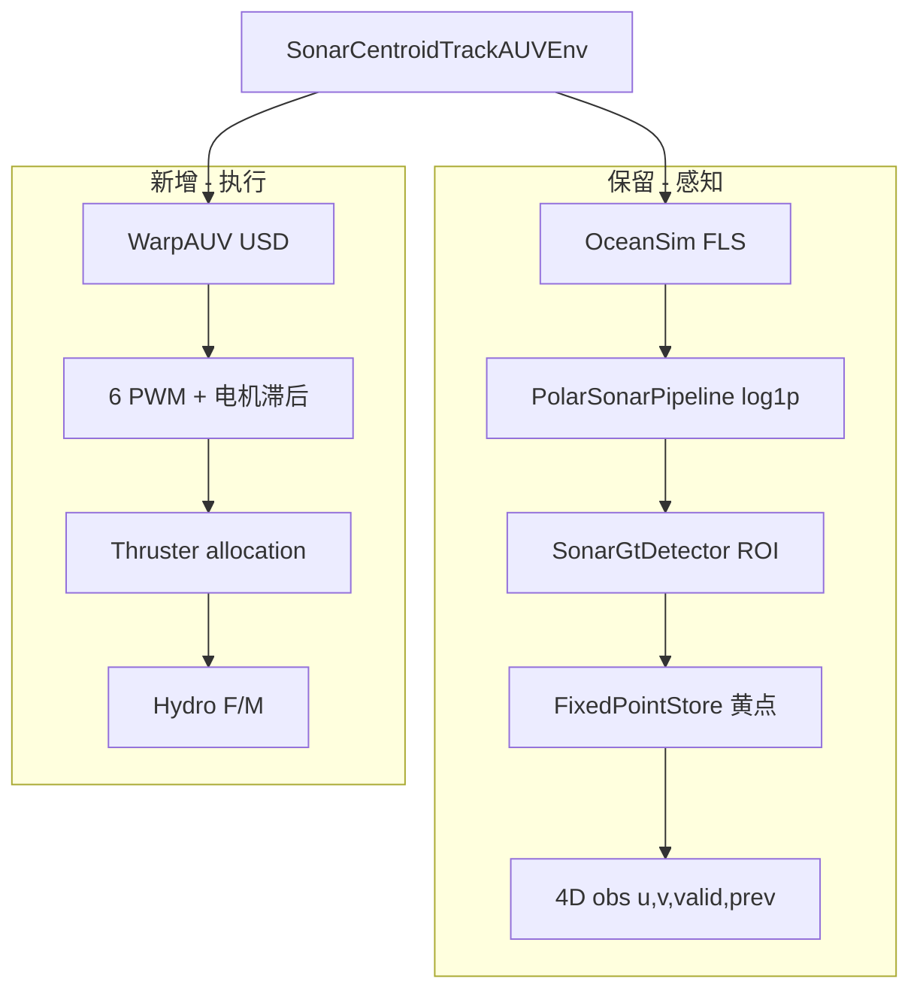

# 声纳质心追踪 × WarpAUV（6 推进器 + 水下动力学）

> 在现有 **sonar centroid track** 感知栈（polar → 绿/黄点 → 4D obs）上，  
> 将 **Cuboid 1D kinematic 机器人** 替换为 **isaac-auv-env WarpAUV + 6 PWM + 解析水动力**。  
> **Phase A0 已实现并通过冒烟测试（2026-07-07）；Cuboid env 与 checkpoint 流程保持不变。**

关联文档：`[PROJECT_PLAN.md](./PROJECT_PLAN.md)`（Cuboid + sine PPO 已跑通版本）

---

## 0. 文档与状态


| 文档                                     | 用途                                |
| -------------------------------------- | --------------------------------- |
| **本文**                                 | AUV 迁移方案、接口约定、分阶段路线               |
| `[PROJECT_PLAN.md](./PROJECT_PLAN.md)` | 当前 Cuboid 1D 任务定义与模块说明            |
| `../isaac-auv-env/`                    | WarpAUV USD、推进器、水动力（warplab 嵌套仓库） |
| `../residual_rl/`                      | PD 基控 + SAC 残差 + 推进器分配（本地参考实现）    |


| 组件                                    | 状态                                  |
| ------------------------------------- | ----------------------------------- |
| Cuboid + sine continuous PPO best     | ✅ |d_col|≈0.39 px（见 GitHub Release） |
| WarpAUV 资产与 `Isaac-WarpAUV-Direct-v1` | ✅ 仓库内已有                             |
| Sonar on WarpAUV                      | ✅ Phase A0 冒烟通过（2026-07-07）         |
| 6 推进器 1D 跟踪（PD + 分配）                  | ✅ Phase A1 P-control eval |
| AUV 补偿 PPO（6D obs + 2D residual）           | 🔲 Phase A2 脚手架就绪       |
| Full 6-DOF                            | 🔲 Phase A3（可选）                     |


---

## 1. 目标


| #   | 目标       | 说明                                      |
| --- | -------- | --------------------------------------- |
| 1   | **换机器人** | `WARPAUV_CFG` USD（~22.7 kg 刚体）替代 Cuboid |
| 2   | **换执行器** | 6 推进器 PWM，替代 body-Y kinematic 写速度       |
| 3   | **换物理**  | 浮力 + 二次阻力 + 粘性阻尼（解析模型，非 ocean USD）      |
| 4   | **保留感知** | OceanSim FLS、ROI 亮斑、固定点、4D image obs    |
| 5   | **保留任务** | 初期仍做 **sine 横向 1D 跟踪**；后期可扩 6-DOF       |


**不目标（本阶段）：** Isaac Sim 流体/ocean 体渲染、迁移旧 PPO checkpoint。

---

## 2. 现状 vs 目标


| 维度         | 当前（Cuboid）                               | 目标（WarpAUV）                                  |
| ---------- | ---------------------------------------- | -------------------------------------------- |
| 机器人        | Cuboid 0.6×0.35×0.25 m，`RigidObject`     | `data/warpauv/warpauv.usd`                   |
| 控制         | 1-DOF：`vy`，`write_root_velocity` + 运动学投影 | 6×PWM → 推力 → `set_external_force_and_torque` |
| 物理         | 重力=0，锁 surge/heave/yaw                   | 重力开 + `HydrodynamicForceModels`              |
| Sim        | 50 Hz，decimation=5 → **10 Hz** 控制        | 120 Hz，decimation=2 → **60 Hz** 控制           |
| 世界 Z       | 工作面 Z≈10 m（无深度语义）                        | WarpAUV 惯例：**Z 正 = 深度**（如 8 m）               |
| 场景         | ground + light，无水体 USD                   | 同左（解析水动力，无 ocean mesh）                       |
| Checkpoint | sine continuous best 可用                  | **全部需重训**                                    |


---

## 3. isaac-auv-env 要点

**Canonical 路径：**

```
source/isaaclab_tasks/isaaclab_tasks/direct/isaac-auv-env/
```

（`allegro_hand/isaac-auv-env/` 为重复 clone，**不使用**。）

### 3.1 六推进器布局

定义于 `thruster_dynamics.py::get_thruster_com_and_orientations()`：


| 索引  | 名称            | 作用      |
| --- | ------------- | ------- |
| 0   | `drive_left`  | 后部左水平主推 |
| 1   | `drive_right` | 后部右水平主推 |
| 2   | `rear_left`   | 后部左斜向   |
| 3   | `rear_right`  | 后部右斜向   |
| 4   | `front_left`  | 前部左斜向   |
| 5   | `front_right` | 前部右斜向   |


### 3.2 控制与动力学链

```
action[6] ∈ [-1, 1]
    → DynamicsFirstOrder (τ≈0.05 s)
    → ConversionFunctionBasic (RPM → 推力)
    → 6 力/力矩合成
    → robot.set_external_force_and_torque(F, M)
    + HydrodynamicForceModels (浮力、二次阻力、线性粘性)
```

### 3.3 已注册任务


| Gym ID                    | 用途                          |
| ------------------------- | --------------------------- |
| `Isaac-WarpAUV-Direct-v1` | 原生 goal-reaching，RSL-RL PPO |
| `Isaac-ResidualRL-*`      | 本地扩展：PD + SAC 残差            |


### 3.4 关键文件


| 文件                                      | 作用                             |
| --------------------------------------- | ------------------------------ |
| `warpauv_env.py`                        | `WarpAUVEnv` / `WarpAUVEnvCfg` |
| `assets/warpauv.py`                     | `WARPAUV_CFG` spawn            |
| `thruster_dynamics.py`                  | 推进器几何 + 电机模型                   |
| `rigid_body_hydrodynamics.py`           | 水动力                            |
| `../residual_rl/thruster_allocation.py` | 6×6 wrench → PWM 伪逆            |
| `../residual_rl/base_controller.py`     | PD 基控参考                        |


---

## 4. 集成架构（推荐）

**新建 env**，不直接改 `WarpAUVEnv` 或破坏现有 `SonarCentroidTrackEnv`：

```
SonarCentroidTrackAUVEnv
├── 执行层：复用 isaac-auv-env 推进器 + 水动力（组合或子类）
├── 感知层：复用 modules/（sonar_pipeline, sonar_gt, fixed_point, observation）
└── 任务层：复用 target_motion（sine）、rewards、terminations（按需扩展）
```




**建议新 Gym ID（实施时注册）：**

- `Isaac-SonarCentroidTrack-AUV-Debug-Direct-v0`
- `Isaac-SonarCentroidTrack-AUV-Continuous-PPO-Direct-v0`
- `Isaac-SonarCentroidTrack-AUV-Continuous-Eval-Direct-v0`
- `Isaac-SonarCentroidTrack-AUV-Residual-PPO-Direct-v0`（Phase A2）
- `Isaac-SonarCentroidTrack-AUV-Residual-Eval-Direct-v0`

---

## 5. 分阶段路线

### Phase A0 — 资产 + Sonar 静态验证

**目标：** WarpAUV 上 FLS 出图，fixed-point teach 成功。


| 工作项         | 说明                                                  |
| ----------- | --------------------------------------------------- |
| `ROBOT_CFG` | `shared_platform` 或 AUV 专用 platform 换 `WARPAUV_CFG` |
| Sonar 挂载    | 标定 `sonar_mount_offset_local`（对照 USD/CAD）           |
| 坐标          | 统一 WarpAUV 深度 Z 与 spawn；文档化 world frame             |
| 悬停          | PWM≈0，验证浮力平衡后 sonar 稳定                              |
| Debug       | 扩展 validation 脚本支持 AUV cfg                          |


**判据：** reset 后 `gap(fixed, sonar) < 1.5 px`；`valid_ratio=1` 持续 ≥10 步。

**实现（已完成）：**


| 文件                                                  | 说明                                                              |
| --------------------------------------------------- | --------------------------------------------------------------- |
| `auv_platform.py`                                   | `WARPAUV_CFG`、sim 120 Hz、depth=8、sonar mount 初值 `(0.35,0,0.05)` |
| `modules/auv_dynamics.py`                           | `WarpAUVDynamicsHelper` — 6 PWM + 解析水动力                         |
| `sonar_centroid_track_auv_env_cfg.py`               | `SonarCentroidTrackAUVEnvCfg` / `DebugCfg`                      |
| `sonar_centroid_track_auv_env.py`                   | `SonarCentroidTrackAUVEnv` — hover（零 PWM）+ sonar                |
| `scripts/debug_centroid_track_auv_sonar.py` + `.sh` | Phase A0 冒烟                                                     |


**Gym ID：** `Isaac-SonarCentroidTrack-AUV-Debug-Direct-v0`

**运行：**

```bash
./scripts/debug_centroid_track_auv_sonar.sh
# 或
./isaaclab.sh -p scripts/debug_centroid_track_auv_sonar.py \
  --task Isaac-SonarCentroidTrack-AUV-Debug-Direct-v0 --headless
```

**冒烟结果（120 steps, headless）：**

- reset：`fixed=(31.6,38.2) sonar=(31.6,38.2) gap=0.00 px` ✅
- `valid=1.00` 全程；depth Z 8.000 → 7.991（浮力微漂，可接受）
- `sonar_abs` vs `perc_abs` 列差 ~5.7 px（ROI 椭圆中心 vs 全局 teach，Phase A1 前可再标定 mount）

---

### Phase A1 — 1D 跟踪 + 6 推进器（PD 闭环）

**目标：** 仍跟踪 sine 横向小球，用 **真实推进器** 产生 sway。


| 工作项          | 说明                                                                          |
| ------------ | --------------------------------------------------------------------------- |
| 移除 kinematic | 不用 `enforce_lateral_1d_kinematics` / `lateral_1d_only`                      |
| 低层控制         | `vy_cmd = kff·target_vy + kp·(Δcol/W)` → wrench `[0,Fy,0,0,0,0]` → 分配 6 PWM |
| 姿态/深度保持      | PD 约束 depth、roll/pitch（防翻沉）                                                 |
| Sim 频率       | 对齐 120 Hz / decimation=2；评估 sonar render 开销                                 |
| Termination  | 保留 lost-track；加 depth/yaw 越界                                                |


**判据：** P 控制 d_col mean < 2 px，success 跟完一个 sine 来回。

**Phase A1 进度（2026-07-07，位置环 + lead，`kp_img=0`）：**

| 配置 | \|d_col\| mean | \|sway−target\| mean | 备注 |
|------|----------------|---------------------|------|
| 初版 image P + PD | ~6.8 px | ~0.82 m | 不稳定 |
| 位置 + lead + kp_vy + vy FF | **6.70 px** | **0.037 m** | 最佳 `@ vy=0.28` |
| vy=0.20 / 0.18 降速 | ~6.6–6.8 px | 0.06–0.07 m | 未明显改善 d_col |

- 控制律：`desired = tgt_dy + lead_s·tgt_vy + kp_sway·(tgt_dy−sway) + kp_vy·(tgt_vy−vy_robot)` → 低层 PD + 6 PWM
- 默认参数：`kp_sway=6.0, lead_s=0.62, kp_vy=0.55, auv_pos_kp=14, auv_pos_kd=3.5`
- 脚本：`scripts/eval_centroid_track_p_control_auv.sh`（`--tune` 扫参）
- **结论：** 侧向位置已跟到 ~4 cm 均值，但 **\|d_col\| 仍 ~7 px**（leg 中段/apex ~7–11 px，中心 ~0.1 px）。纯位置环无法达到 <2 px；需图像闭环或 Phase A2 PPO residual。

**参考：** `scripts/eval_centroid_track_p_control.py` + `residual_rl/thruster_allocation.py`。

---

### Phase A2 — 补偿 PPO（AUV 版）

**目标：** 在 **纯图像 P + 绿点距离 hold** 基控上，用 PPO 学 **残差补偿**，改善 sine 跟踪；**不使用 GT vy 前馈**。

#### 控制架构

```
每步:
  base_sway, base_surge ← 纯图像 P (kff=0) + range hold（固定，不学习）
  Δsway, Δsurge         ← PPO 输出 ∈ [-1,1]，缩放 ±0.20 / ±0.35 m
  desired = base + Δ    → AUVLateralController PD → 6 PWM
```

- **横向基控**：`vy = kp·(Δcol/W)`，积分到 sway 设定（与 eval `kff=0` 一致）
- **距离基控**：`range_sonar`（绿点）vs `range_gt_reset`（reset GT）；`desired_surge = kp_range·(sonar−gt_reset) − hold`
- **无 oracle**：不读 `target_vy`、不用 `set_auv_feedforward_vy`

#### 观测（6D）

| idx | 符号 | 含义 |
|-----|------|------|
| 0 | `u_norm` | `(green_col − yellow_col) / W` |
| 1 | `v_norm` | `(green_row − yellow_row) / H` |
| 2 | `valid` | 绿点是否检测到 |
| 3 | `d_range_norm` | `clip((range_sonar − range_gt_reset) / 0.5, ±1)`；**\|误差\| ≤ 0.5 m 可接受** |
| 4 | `prev_Δsway` | 上步 residual action[0] |
| 5 | `prev_Δsurge` | 上步 residual action[1] |

- **`range_sonar`**：当前帧绿点 row → 水平距离（m），**声纳图像估计**
- **`range_gt_reset`**：reset 时 **GT** 声纳 mount → 小球水平距离（m，`beacon_bearing_range`），整段 episode 不变

#### 动作（2D）

`Box(-1,1)²` → `[Δsway, Δsurge]`，叠加在基控 setpoint 上。

#### 奖励

```
r -= w_u·|u| + w_v·|v|                         # 图像跟踪
r -= w_range·max(0, |err| − 0.5)              # ±0.5 m 内不罚
r -= w_close·max(0, −err − 0.5)               # 比 GT 近超过 0.5 m 额外罚
r -= w_res·||a − a_prev||²                    # residual 平滑
```

**终止**：lost-track、深度越界、**声纳距离比 reset GT 近 > 0.5 m**。

#### 文件 / 入口

| 文件 | 说明 |
|------|------|
| `modules/auv_image_range_base.py` | 纯图像 P + range hold 基控 |
| `sonar_centroid_track_auv_env.py` | `auv_residual_ppo=True` 控制环 |
| `sonar_centroid_track_auv_env_cfg.py` | `SonarCentroidTrackAUVResidualPpoCfg` |
| `agents/skrl_ppo_continuous_auv_cfg.yaml` | skrl PPO 超参 |
| `scripts/train_centroid_track_auv_ppo.sh` | 训练入口 |

**Gym ID：**

- 训练：`Isaac-SonarCentroidTrack-AUV-Residual-PPO-Direct-v0`
- 评测：`Isaac-SonarCentroidTrack-AUV-Residual-Eval-Direct-v0`

**运行：**

```bash
./scripts/train_centroid_track_auv_ppo.sh
# NUM_ENVS=4 MAX_ITERS=3000 ./scripts/train_centroid_track_auv_ppo.sh
```

**判据：** sine eval `|d_col|` mean < 2 px，`range_drift` < 0.05 m，success_rate > 70%。

**Phase A1 结论（仍有效）：** 纯位置环 / 纯图像 P（无前馈）单独不足以跟 sine；PPO residual 用于补动态滞后与 6DOF 耦合。

---

### Phase A3 — Full 6-DOF（可选）

- 小球 3D 轨迹、yaw 对准、heave 补偿
- 域随机：COM/COB、推进器 bias（`WarpAUVEnvCfg.domain_randomization`）
- 参考 `residual_rl` Stage2/3 水流 DR

---

## 6. 文件改动清单（实施时）

### 新建（建议）


| 路径                                         | 说明                          |
| ------------------------------------------ | --------------------------- |
| `sonar_centroid_track_auv_env.py`          | AUV env 主逻辑                 |
| `sonar_centroid_track_auv_env_cfg.py`      | AUV cfg                     |
| `auv_platform.py` 或扩展 `shared_platform.py` | `WARPAUV_CFG` + sonar mount |
| `modules/thruster_control.py`              | vy/wrench → PWM 封装          |
| `agents/skrl_ppo_continuous_auv_cfg.yaml`  | PPO 超参                      |
| `scripts/train_centroid_track_auv_*.sh`    | 训练/评测入口                     |


### 修改


| 路径                   | 说明                  |
| -------------------- | ------------------- |
| `__init__.py`        | 注册 AUV Gym ID       |
| `shared_platform.py` | 可选双模式 `use_warpauv` |


### 基本不动


| 路径                                | 说明        |
| --------------------------------- | --------- |
| `modules/sonar_pipeline.py`       | polar 预处理 |
| `modules/sonar_gt.py`             | 亮斑检测      |
| `modules/fixed_point.py`          | 黄点 teach  |
| `modules/observation.py`          | 4D obs 构建 |
| `modules/target_motion.py`        | sine 小球   |
| `nonar2/oceansim_sonar_sensor.py` | FLS 传感器   |


### 复用（import，不 fork）


| 来源                                          | 内容    |
| ------------------------------------------- | ----- |
| `isaac-auv-env/thruster_dynamics.py`        | 推进器模型 |
| `isaac-auv-env/rigid_body_hydrodynamics.py` | 水动力   |
| `residual_rl/thruster_allocation.py`        | 分配矩阵  |


---

## 7. 风险与对策


| 风险                                | 对策                                      |
| --------------------------------- | --------------------------------------- |
| Z 轴/深度坐标不一致                       | Phase A0 专门做 spawn + debug 可视化          |
| Sonar 挂载未标定                       | 对照 `warpauv.usd`；A1 前必须测 gap            |
| kinematic → 力控 lag 变大             | 先 PD+分配；提高 sim Hz                       |
| 无 ocean USD                       | 接受解析模型；后期可加环境 asset                     |
| Sonar render + 120 Hz GPU 压力      | 先 num_envs=1；必要时 decimation 与 render 解耦 |
| isaac-auv-env 版本（README: Sim 4.5） | A0 冒烟 API 兼容性                           |
| 旧 checkpoint 不可用                  | 文档明确；新 experiment / Release             |


---

## 8. 待决策（TBD）


| #   | 问题               | 选项                                        |
| --- | ---------------- | ----------------------------------------- |
| 1   | 是否保留 Cuboid 双模式？ | `use_cuboid / use_warpauv` cfg 开关         |
| 2   | A1 控制策略          | **A)** PD+wrench+分配 **B)** 直接 6 PWM RL    |
| 3   | 深度设定             | WarpAUV `starting_depth=8` vs 现有 Z=10 工作面 |
| 4   | 任务范围             | 仅 1D sine vs 初期 3D                        |
| 5   | 训练栈              | 继续 skrl vs RSL-RL（WarpAUV 原生）             |
| 6   | Sonar 更新率        | 每 control step render vs 降频 cache         |


---

## 9. 里程碑


| ID  | 内容                               | 粗估           |
| --- | -------------------------------- | ------------ |
| A0  | WarpAUV + sonar 静态 + fixed-point | ✅ 2026-07-07 |
| A1  | PD + 6PWM 分配，1D sine P 控制 eval     | ✅ 2026-07-07 |
| A2  | 补偿 PPO 脚手架（6D obs + 2D residual） | ✅ 2026-07-07 |
| A3  | AUV PPO 训练至判据达标                  | 训练 + 调参      |
| A4  | 6-DOF 扩展                         | 按需           |


---

## 10. 与 Cuboid 版本的继承关系

```
PROJECT_PLAN.md (Cuboid 1D)          PROJECT_PLAN_AUV.md (本文)
        │                                      │
        ├─ modules M2–M7 感知 ─────────────────┤ 原样继承
        ├─ sine target_motion ───────────────┤ 原样继承
        ├─ PPO 4D obs 语义 ──────────────────┤ 原样继承
        └─ kinematic actions ────────────────┴─► 替换为 6 PWM + hydro
```

**GitHub 基线（Cuboid sine best）：**  
[https://github.com/lh123-123/isaaclab-sonar-centroid](https://github.com/lh123-123/isaaclab-sonar-centroid)  
Tag: `sonar-centroid-sine-ppo-v1`

---

## 11. 下一步

1. **Phase A3**：运行 `./scripts/train_centroid_track_auv_ppo.sh`，调 `kp` / residual 幅度 / reward 权重。
2. 训练后 eval：`Isaac-SonarCentroidTrack-AUV-Residual-Eval-Direct-v0` + checkpoint play。
3. 可选：微调 `AUV_SONAR_MOUNT_OFFSET_LOCAL` 缩小几何–图像列差。
4. **不改** 现有 Cuboid env 与 checkpoint 流程。

