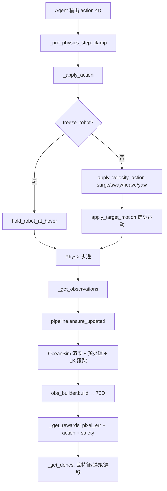
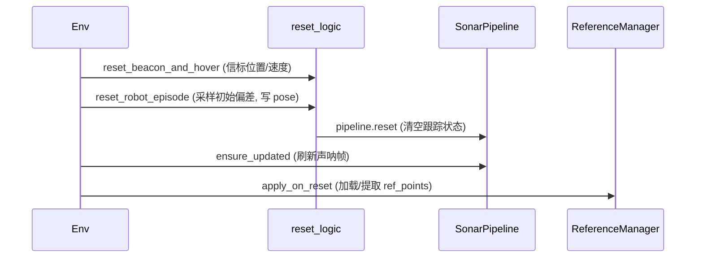
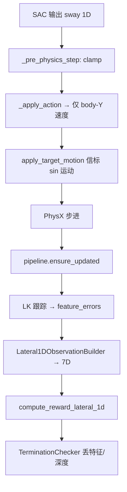

# Sonar IBVS-DRL 代码框架

基于声呐稀疏特征视觉伺服 + 深度强化学习的 AUV 悬停/跟踪任务。

---

## 1. 分层架构

```
┌─────────────────────────────────────────────────────────────────┐
│  入口层                                                          │
│  __init__.py (Gym 注册)  ·  scripts/ (teach / eval / debug)     │
│  agents/skrl_sac_cfg.yaml (SAC 训练超参)                         │
└────────────────────────────┬────────────────────────────────────┘
                             │
┌────────────────────────────▼────────────────────────────────────┐
│  编排层                                                          │
│  sonar_ibvs_drl_env.py   — DirectRLEnv 生命周期，不含算法细节    │
│  sonar_ibvs_drl_env_cfg.py — 场景/奖励/课程参数                  │
└────────────────────────────┬────────────────────────────────────┘
                             │
        ┌────────────────────┼────────────────────┐
        │                    │                    │
┌───────▼───────┐  ┌─────────▼─────────┐  ┌──────▼──────┐
│ 感知流水线     │  │ 决策信号           │  │ 仿真平台     │
│ modules/      │  │ modules/          │  │ shared_     │
│ sonar_pipeline│  │ observation       │  │ platform.py │
│ sonar_preproc │  │ rewards           │  │ (Nonar2     │
│ sparse_feature│  │ terminations      │  │  机器人+    │
│ _tracker      │  │ actions           │  │  OceanSim)  │
└───────────────┘  └───────────────────┘  └─────────────┘
        │                    │
┌───────▼────────────────────▼──────────────────────────────────┐
│  教示 / 参考                                                     │
│  reference_manager.py  ·  reference_snapshot.py                 │
└─────────────────────────────────────────────────────────────────┘
```

| 层级 | 职责 | 关键文件 |
|------|------|----------|
| 入口 | 注册任务 ID、启动脚本 | `__init__.py`, `scripts/*` |
| 编排 | Isaac 仿真步进、模块调度 | `sonar_ibvs_drl_env.py` |
| 配置 | 超参、场景、课程 | `sonar_ibvs_drl_env_cfg.py` |
| 感知 | 声呐→图像→特征跟踪 | `sonar_pipeline.py`, `sparse_feature_tracker.py` |
| 决策 | 观测/奖励/终止/动作 | `modules/observation.py` 等 |
| 教示 | 参考点保存与加载 | `reference_manager.py`, `reference_snapshot.py` |
| 平台 | 机器人、信标、声呐硬件抽象 | `shared_platform.py` |

---

## 2. 核心类与职责

### `SonarIbvsDrlEnv`（编排器）

持有 4 个核心子模块 + 场景状态张量，本身不做算法计算：

| 成员 | 类型 | 作用 |
|------|------|------|
| `pipeline` | `SonarPerceptionPipeline` | 每步更新声呐图像与特征跟踪 |
| `ref_mgr` | `ReferenceManager` | 教示参考点（file/capture/geometry） |
| `obs_builder` | `ObservationBuilder` | 组装 72 维 policy 观测 |
| `term_checker` | `TerminationChecker` | 判定 episode 终止 |

场景状态（env 私有）：`_station_origin_w`, `_beacon_pos_w`, `_beacon_vel_w`, `actions` 等。

### `SonarPerceptionPipeline`（感知流水线）

```
原始声呐 (N,64,128)
    │  sonar_preprocess.log_compress + median_filter
    │  sonar_preprocess.polar_to_cartesian
    ▼
笛卡尔图 (N,128,128)
    │  SparseFeatureTracker.update (LK 光流)
    ▼
特征误差 e = p_t - p_ref, 有效标志 valid
```

每仿真步只更新一次（`_cache_step` 去重）。

### `ReferenceManager`（教示管理）

三种 `reference_mode`：

| 模式 | 行为 |
|------|------|
| `file` | 从 `station_ref.npz` 加载 `ref_points` |
| `capture` | reset 后在当前帧 FAST 提取特征 |
| `geometry` | 用信标投影 ROI 辅助 FAST 提取 |

Teach 脚本调用 `capture_reference_snapshot()` → 写入 `.npz`。

### `SparseFeatureTracker`（IBVS 核心）

1. **教示**：`extract_features()` — FAST 角点，最多 30 个，保留 20 个
2. **跟踪**：`calcOpticalFlowPyrLK` 前向 + 后向校验（fb_error < 1.0）
3. **输出**：像素误差向量、有效点数量、归一化误差（奖励用）

---

## 3. 单步数据流（RL step）



**观测 72 维布局**（`modules/constants.py`）：

```
[0:40]   特征像素误差 (20点×2, 无效填0, 除以对角线)
[40:60]  有效标志 (0/1)
[60:68]  本体: roll,pitch,yaw, ω×3, depth, ż
[68:72]  上一动作
```

**动作 4 维**：`[surge, sway, heave, yaw]` ∈ [-1,1] → 缩放为线/角速度写入仿真。

**奖励**：
```
r = -w1·mean(||e_i||)/diagonal - w2·||a||² - w3·safety
safety = 1 若 depth越界 或 valid_pts < 3
```

---

## 4. Reset 流程



- **Stage1**：小偏差 spawn（0.2m, 5°），静态信标
- **Stage2+**：更大偏差、水流、目标运动（cfg 中 `target_speed_max`）

---

## 5. 工作流（Teach → Train → Eval）

**控制归属：DRL 为主路径；P 控制仅作调试基线，不参与训练。**

```
Teach                         Train (主)                    Eval
─────                         ──────────                    ────
Debug / Lateral1D-Debug       Lateral1D-Direct              play / eval checkpoint
FAST 提取特征           →     station_ref.npz         →     SAC 输出 sway
保存 .npz                     SAC 7D obs → 1D action        get_ibvs_metrics()

可选基线（非训练）:
  run_lateral1d_p_control.py  — hybrid / ibvs_only P 控制，对比像素跟踪 vs 横向误差
```

| 脚本 | 用途 |
|------|------|
| `scripts/teach_sonar_flow_station.py` | 教示，生成 `logs/station_ref/station_ref.npz` |
| `scripts/train_sonar_lateral1d_sac.sh` | **Lateral1D SAC 训练（主）** |
| `scripts/eval_lateral1d_checkpoints.py` | Lateral1D checkpoint 评估 |
| `scripts/run_lateral1d_p_control.py` | **P 控制基线**（hybrid/ibvs 对比，不训练） |
| `scripts/debug_ibvs_modules.py` | **离线**逐层测试（无需 Isaac Sim） |
| `scripts/debug_sonar_flow_hover.py` | GUI 声呐 + 特征 debug |
| `scripts/eval_sonar_flow_hover.py` | 策略评估 / 冒烟测试 |
| `skrl/train.py --task Isaac-SonarIbvsDrl-Stage1-Direct-v0` | 全 4D SAC 课程训练 |

---

## 6. 目录树

```
sonar_flow_hover/
├── __init__.py                 # Gym 任务注册
├── sonar_ibvs_drl_env.py       # 环境编排（~300 行）
├── sonar_ibvs_drl_env_cfg.py   # 配置 + 课程 Stage1/2
├── sonar_flow_hover_env*.py    # 向后兼容 re-export
│
├── shared_platform.py          # Nonar2 机器人 + OceanSim 声呐
├── sonar_preprocess.py         # log + 滤波 + 极坐标→笛卡尔
├── sparse_feature_tracker.py   # FAST + LK 光流
├── reference_snapshot.py       # .npz 教示快照读写
│
├── modules/
│   ├── constants.py            # 维度、观测切片
│   ├── geometry.py             # 信标方位、ROI、欧拉角（纯 torch）
│   ├── sonar_pipeline.py       # 感知流水线封装
│   ├── reference_manager.py    # 教示参考点管理
│   ├── observation.py          # ObservationBuilder
│   ├── rewards.py              # compute_reward
│   ├── terminations.py         # TerminationChecker
│   ├── actions.py              # 速度控制 + 信标运动
│   ├── reset_logic.py          # reset 采样与布置
│   └── debug.py                # collect_metrics / decode_observation
│
└── agents/
    ├── skrl_sac_cfg.yaml       # SAC（主算法）
    └── skrl_ppo_cfg.yaml       # PPO（兼容旧任务 ID）
```

---

## 7. Debug 入口

### 离线（推荐先跑）

```bash
python scripts/debug_ibvs_modules.py --layer all
python scripts/debug_ibvs_modules.py --layer tracker
```

### 仿真内

```python
m = env.unwrapped.get_ibvs_metrics(env_id=0)
# valid_pts, pixel_err, pos_err_m, depth_m, vel_m_s, action

from isaaclab_tasks.direct.sonar_flow_hover.modules.debug import decode_observation
parts = decode_observation(obs[0])  # feat_err / valid_flags / body / prev_action
```

### 逐模块断点建议

| 现象 | 优先检查模块 |
|------|-------------|
| 声呐图全黑/异常 | `sonar_preprocess.py`, OceanSim 配置 |
| 教示 0 特征点 | `sparse_feature_tracker.extract_features`, ROI (`geometry.beacon_image_rois`) |
| 跟踪频繁丢失 | `fb_error_threshold`, `sparse_feature_tracker._lk_track` |
| 观测维度不对 | `modules/constants.py`, `ObservationBuilder.build` |
| 奖励恒为负大 | `rewards.py` safety 项（valid_pts < 3） |
| 一 reset 就 terminate | `terminations.py` 漂移/深度界 |

---

## 8. 任务 ID 一览

| ID | 配置 | 用途 |
|----|------|------|
| `Isaac-SonarIbvsDrl-Debug-Direct-v0` | DebugCfg | 教示 / GUI debug |
| `Isaac-SonarIbvsDrl-Stage1-Direct-v0` | Stage1Cfg | 课程训练 |
| `Isaac-SonarIbvsDrl-Stage2-Direct-v0` | Stage2Cfg | 课程训练 |
| `Isaac-SonarIbvsDrl-Eval-Direct-v0` | EvalCfg | 评估 |
| `Isaac-SonarIbvsDrl-Lateral1D-Direct-v0` | Lateral1DCfg | **1D 横向跟踪 SAC 训练（主）** |
| `Isaac-SonarIbvsDrl-Lateral1D-Debug-Direct-v0` | Lateral1DDebugCfg | 1D GUI debug / P 控制脚本 |
| `Isaac-SonarFlowHover-*` | 同上 | 向后兼容别名 |

---

## 9. Lateral 1D 任务（当前主线）

### 9.1 分层：感知共享，控制归 DRL

```
┌──────────────────────────────────────────────────────────────┐
│  感知层（env 内，DRL / P 控制共用）                              │
│  声呐 polar → log+滤波 → 笛卡尔 cart → LK 跟踪 → e = p_t-p_ref │
└────────────────────────────┬─────────────────────────────────┘
                             │ feature_errors, valid, cart_image
              ┌──────────────┴──────────────┐
              │                             │
┌─────────────▼─────────────┐   ┌───────────▼──────────────────┐
│  控制：SAC（主路径）        │   │  控制：P 基线（仅 debug）      │
│  7D obs → sway ∈ [-1,1]   │   │  hybrid / ibvs_only / beacon  │
│  skrl SAC 训练 + play     │   │  run_lateral1d_p_control.py   │
└───────────────────────────┘   └───────────────────────────────┘
```

| 模块 | 文件 | 职责 |
|------|------|------|
| 环境编排 | `sonar_ibvs_drl_env.py` | 仿真步进、调用感知、把 **agent action** 写入 sway |
| 紧凑观测 | `modules/observation.py` → `Lateral1DObservationBuilder` | 组装 7D policy 输入 |
| 横向奖励 | `modules/rewards.py` → `compute_reward_lateral_1d` | `-w1·\|mean_ex\| - w2·a² - w3·safety` |
| P 基线 | `modules/lateral_p_controller.py` | **脚本外**调用，env 本身不含 P 控制 |
| SAC 超参 | `agents/skrl_sac_lateral1d_cfg.yaml` | 7→1 MLP，300k steps |

### 9.2 任务设定

- AUV 与信标仅在 **body-Y（sway）** 运动；surge / heave / yaw 锁定
- 信标横向：`target_dy = A·sin(2πt/T)`，默认 `A=1.5 m`，`T=8 s`（峰值速度 ≈ 1.18 m/s）
- 教示参考：`logs/station_ref/station_ref.npz`（FAST 角点 + patch 质量门控，通常 5 点）
- 实际可跟踪：多数 run 中 **T0 + T4** 稳定（valid=2），T1–T3 常无效

### 9.3 7D 紧凑观测（`Lateral1DObservationBuilder`）

默认 `perception_frame=polar`（Lateral1D）：在 **极坐标预处理图** 上跟踪，横向误差为 **Δaz**。

```
[0] mean_daz     有效特征方位列误差均值 / W（polar）或 ex/diag（cart）
[1] mean_dr      有效特征距离行误差均值 / H（polar）或 ey/diag（cart）
[2] valid_ratio  有效特征数 / max_track_points
[3] robot_lat    机器人相对 hover 的 body-Y 偏移 / A
[4] target_dy    信标目标 body-Y 偏移 / A
[5] target_dy_vel 目标横向速度 / (A/T_scale)
[6] prev_sway    上一步 sway 动作
```

切换回笛卡尔：`SonarIbvsDrlEnvCfg.perception_frame = "cart"`。

### 9.4 P 控制基线结论（供 reward / curriculum 参考，非生产控制）

在 `run_lateral1d_p_control.py` 中验证（笛卡尔 cart 图上的特征误差）：

| 模式 | 公式概要 | 200 step \|lat_err\| 均值 |
|------|----------|---------------------------|
| `ibvs_only` | `sway = Kp·mean_ex` | ~1.37 m（像素小但横向漂移） |
| `hybrid` | `Kp·mean_ex + Kp_geo·(target−robot)/A + Kff·target_vel` | ~0.11–0.23 m |

Hybrid 中 **P_geo / FF 仅存在于 debug 脚本**；DRL 通过 obs 中的 `robot_lat`、`target_dy`、`target_dy_vel` 自行学习等价项。

### 9.5 Lateral1D 单步数据流（RL）



训练命令：

```bash
./scripts/train_sonar_lateral1d_sac.sh --headless --enable_cameras --num_envs 8
```

---

## 10. 方法本质（全任务 + Lateral1D）

**全 4D 任务（Stage1/2）：**

```
教示帧 → FAST 提取 → {p_ref}（固定）
当前帧 → LK 跟踪 + 过滤 → {p_t}
         ↓
  误差 e = p_t - p_ref
         ↓
IMU/深度计 + e + 上一动作 → 72D 观测 → SAC → 4D 推力
         ↓
  reward = -||e||² - ||a||² - safety
```

**Lateral1D（当前主线）：**

```
同上感知流水线 → mean_ex + target 状态 + prev_sway → 7D → SAC → sway
reward = -w1·|mean_ex| - w2·sway² - w3·safety
```

DRL 策略替代传统 IBVS 解析雅可比 **以及** P-control 手工增益；P 控制脚本仅保留为可重复基线。
